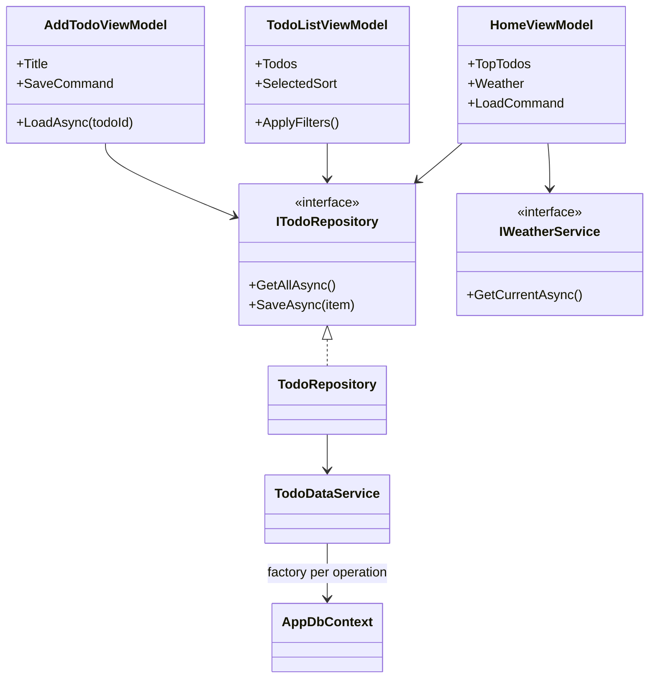
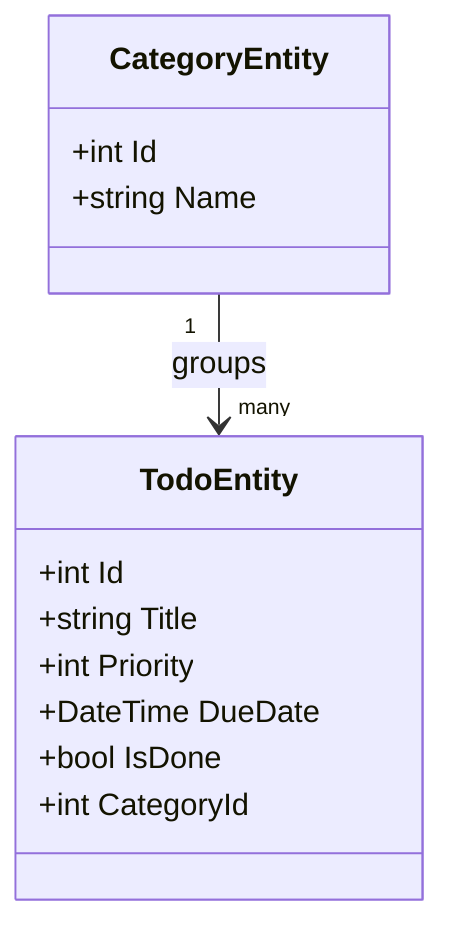

# LifeManagementApp

A small .NET MAUI application for organising daily tasks and checking the current weather in Vaasa. Built for **TT00BI73-3008 Client-Side Programming**, following the course's .NET 9, MVVM, CommunityToolkit and EF Core approach.

Start with **[START_HERE_SI.md](START_HERE_SI.md)** for the Sinhala setup instructions. The code walkthrough and presentation practice are in `docs/`.

The printable **[Sinhala study and presentation guide](docs/LifeManagementApp_Study_Guide_SI.pdf)** combines the setup, code walkthrough and demo practice.

## Features

- Today dashboard: three unfinished tasks, highest priority first, then earliest due date.
- Current temperature and wind from Open-Meteo, explicitly requested in metres per second.
- A kite alert for wind **strictly above 5 m/s**.
- Task list with both priority and due-date sorting; the default includes completed tasks too.
- Create and edit tasks, with a required title of at most 40 characters.
- Persistent SQLite storage using EF Core Code First and checked-in migrations.
- A category-to-task one-to-many relationship, category/status filtering and title search.
- Complete, reopen and delete tasks; deletion asks the user first.
- Loading indicators, useful error messages and a working local task list when weather is unavailable.
- xUnit tests for business rules, ViewModels, JSON handling and real SQLite persistence.

The initial task list is empty. Categories are created by the initial migration. Weather is real API data; sample weather is not silently substituted.

## Run on Windows

1. Install Visual Studio 2022 **17.12 or later**, or a newer Visual Studio, with the **.NET Multi-platform App UI development** workload and the **.NET 9 SDK**. The course requires .NET 9; having only SDK 10 is not enough for this solution's `global.json`.
2. Extract the ZIP fully to a normal folder, for example `D:\Projects\LifeManagementApp`.
3. Open **LifeManagementApp.sln** in Visual Studio.
4. Right-click the **LifeManagementApp** project inside `src` and select **Set as Startup Project**.
5. Allow NuGet restore to finish, select **Windows Machine**, then press **F5**.

Windows is selected automatically when building on Windows. No API key, database server or VPN is needed. The database is created on the first data request using EF migrations. The device-local path is printed in Visual Studio's Debug Output window.

Command-line build on Windows:

```powershell
dotnet build .\src\LifeManagementApp\LifeManagementApp.csproj -f net9.0-windows10.0.19041.0
```

For Android, install the corresponding MAUI/Android tooling and a device or emulator, and build with `-p:BuildAndroid=true -f net9.0-android`. iOS is outside this project's configured targets.

## Tests and migrations

Run from the solution folder:

```powershell
dotnet test .\tests\LifeManagementApp.Tests\LifeManagementApp.Tests.csproj
```

The tests are a normal .NET 9 project and do not require an Android emulator. Network tests use controlled HTTP responses; database tests use real temporary SQLite files.

The initial migration is already included. You do not need `dotnet ef database update` to run the app. To change the schema later:

```powershell
dotnet tool restore
dotnet ef migrations add YourChangeName --project .\src\LifeManagementApp.Data
dotnet ef migrations has-pending-model-changes --project .\src\LifeManagementApp.Data
```

Read the generated migration, then start the app; its `DatabaseInitializer` applies missing migrations. Do not mix `EnsureCreated` with this migration-based database.

## Structure and design choices

| Project | Responsibility |
| --- | --- |
| `src/LifeManagementApp` | MAUI pages, XAML, colours, converters, Shell navigation and platform APIs |
| `src/LifeManagementApp.Core` | Client models, ViewModels, repository adapter, business rules and weather service, independent of MAUI |
| `src/LifeManagementApp.Data` | Plain database entities, DbContext, migrations and asynchronous database queries |
| `tests/LifeManagementApp.Tests` | Tests and small fake services |

The database class library follows the instructor's database guide. The additional Core library lets the same ViewModel and service code run in xUnit without starting MAUI. It is client-side application logic, not a web server.

At startup, `App` receives `IServiceProvider`, loads `App.xaml` resources, and resolves `AppShell` in `CreateWindow`. The shell must be created after the shared resource dictionaries, because its XAML uses their colours and styles.

Pages bind to a ViewModel. A ViewModel asks an interface for data. `TodoRepository` maps the screen's `TodoItem` to the database's `TodoEntity` and calls `TodoDataService`. ViewModels do not reference controls, EF Core or DbContext.





### DI lifetimes

| Registration | Lifetime | Reason |
| --- | --- | --- |
| Repository, data service, initializer | Singleton | Shared access point, without holding a long-lived DbContext |
| DbContext factory | Singleton factory | Creates and disposes an independent context for each operation |
| HttpClient and weather service | Singleton | Reuses connections and has no page-specific form state |
| Navigation and dialog adapters | Singleton | Thin, stateless wrappers around MAUI |
| Pages and ViewModels | Transient | A new editor starts with fresh form state; Shell retains the current tab pages |

### Course conventions

The code uses one class per file, .NET 9 and Toolkit **field syntax** (`[ObservableProperty] private string title`), as taught in the course. MAUI code-behind contains view construction, lifecycle forwarding and navigation-parameter receipt. Application logic stays in ViewModels and services. AOT/partial-property syntax from newer examples is not required.

## Project plan and assessment evidence

| Area | Implementation |
| --- | --- |
| Functionality | `HomeViewModel`, `TodoRules`, `TodoListViewModel`, `AddTodoViewModel` |
| Pages and parameters | `AppShell`, `MauiNavigationService`, `AddTodoPage.ApplyQueryAttributes` |
| Storage and relationship | `AppDbContext`, `TodoDataService`, `Data/Migrations` |
| MVVM and interfaces | Core ViewModels and Services folders |
| Toolkit and compiled bindings | Observable properties, relay commands, typed page/row bindings and two converters |
| DI | `MauiProgram`, `AddTodoData` and the lifetime table above |
| REST | `OpenMeteoWeatherService`, typed JSON models, error/loading handling |
| Git/documentation | Genuine local development commits, feature branches and these documents |
| B2 candidates | Complete/edit/delete; category filtering |
| B3 candidate | xUnit tests |

The implementation targets the high levels of the eight criteria; the teacher determines the actual score. B1's hosted issues/PR evidence has **not** been created. Local feature branches alone do not establish that bonus. See `docs/GIT_AND_SUBMISSION_SI.md` for the remaining hosting/submission work.

Development checkpoints: solution/data layer; application logic and API; MAUI screens; automated tests; documentation and validation. No commits have been backdated or attributed to the student. The included local history uses `Project assistant`; the student should make their own real improvements and understanding-practice commits.

## AI use

ChatGPT was used to review the supplied VAMK course material and project requirements, generate the initial implementation, tests, UI and explanatory documents, and correct build issues. AI-assisted source files are labelled. The instructor explicitly permits AI assistance and assesses the student's understanding in the presentation. The student must personally run, review and practise changing the code; this README does not claim that those learning steps have already happened. No AI tools may be used during the presentation.

## Validation and remaining checks

See **[docs/VERIFICATION.md](docs/VERIFICATION.md)** for measured results and platform limits. A successful Android build and passing portable tests do not substitute for running the Windows app on the presentation laptop. Complete the manual checklist there before submitting.

## Course sources

Requirements and scheduling were read from the authenticated course on **20 November 2026**. The pages disagree in a few places; `docs/COURSE_REQUIREMENTS.md` records the differences and the current submission-page instructions.

- [Project work overview](https://portal.vamk.fi/course/view.php?id=20189&section=6#tabs-tree-start)
- [Assignment and marking scheme](https://portal.vamk.fi/mod/page/view.php?id=1066900)
- [Actual submission page](https://portal.vamk.fi/mod/assign/view.php?id=1060859)
- [Presentation scheduler](https://portal.vamk.fi/mod/scheduler/view.php?id=1066904)
- [Toolkit essentials](https://portal.vamk.fi/mod/page/view.php?id=1061446)
- [Field versus partial-property syntax](https://portal.vamk.fi/mod/page/view.php?id=1061646)
- [Database class library and migrations guide](https://portal.vamk.fi/mod/page/view.php?id=1067628)

Font attribution is in `THIRD_PARTY_NOTICES.md`. Open-Meteo provides the displayed weather data.
